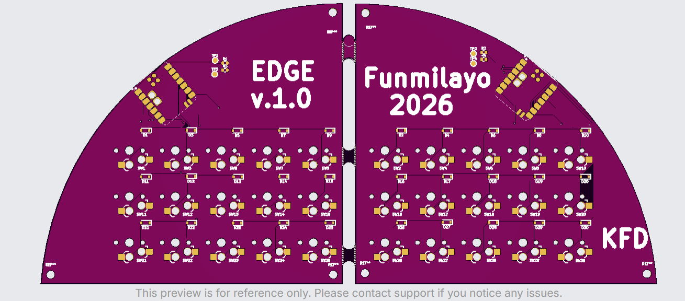

The name of this pretty keeb is Edge! You like it? :P

### DESIGN PHASE: VISUALISATION, SCHEMATIC AND PCB DESIGN

I started off with my split keyboard, after getting stuck on the devboard! I thought of a design, thought to use 30 keys in total - 26 alphabets and some other keys! I added everything necessary and 2 displays. (wanted to add LEDs until I realised the keys we used actually come with those already.. so no more!

I aligned each keyboard and diode with numbers/coordinates and all. That was quite tasking, tbh! But yayy, we got it done.

Once I figure out a couple other things, I will begin routing the PCB and start working on firmware!

## PCB routing

Yh, this took about an hour, I was just routing as usual. And I had a couple of questions like whether or not to route the 2 halves together.

I also placed the mousebites (I used a YT video to do this), added edge.cuts and all of that. I added some text design on silkscreen.

## ZMK firmware

This took a lot of reading, using Gemini, Chat GPT, and some YT videos.

I installed Github CLI and uv and ZMK by following the documentation on the ZMK website. I was also using Gemini in my browser to ask questions as I did it all.

Then I had to create a new keyboard. I was typically using many resources to do this. For example, I looked at someone else's keyboard firmware to see that they used the nice_nano, I used a YT video and I was trying to read the docs on the ZMK site as well. Ofc Gemini and GPT, my friends. I was trying my best to be quick with this after qaking up late today and needing to finish my board to make it to stasis, but I still took so much time.. OCD vibes. 

The YT video I found used ZMK, but just not for a split keyboard, but I just tried to understand the basic parts from there.

I'm still kinda working on it, but for the most part, I think I'm good.

## Changes

I thought of resizing my keeb by putting my micro at the back of the keys, but it woundn't go! So, I stuck with that!

Now done w the CAD, and we done. Spanned like a month over this project, but spent like 30 sumn hours in total!! Can't wait to routee!

---- continuation ----

After routing my pcb, I got it fabricated and ordered the instruments! At first I bought the right switches but wrong sockets and they wouldn't go into my PCB :(, and so I had to reorder. I still thought it was wrong after, cuz i meant to put it on the front of the pcb, not the back! so i just had to make my front my back and vice versa!! I soldered all my switches and sockets (cuz i was so excited that it actually worked!) and then i realised i hadn't done the diodes! they weren't much of a pain but would have been easier if i had done those first!

I soldered my batteries and resistors, and the hardware is done! BUT, I thik i put my boot and reset pads without a space because of the footprints I used. it was actually an altered version! (i'm not even sure if there were supposed to be pads, but there's also a reset button on the front)

I kept trying w just the reset button, and the drive would come up but it wasn't flashing the code for some reason!

Later got it to work, but just like my macropad, the keys were kinda bugging. They have a mind of their own, and type whatever they want to type when I don't want them to type.

In other words, it's like an endless loop! I'm still thinking it's with the hardware just like the macro, because I double checked the code again w many ai sources, and the code does seem right to me. Again, works, but in a weird way! I do plan on making changes soon!

[https://github.com/Dee-24r/Edge/blob/main/images/malfunctioning_keeb.mp4](https://github.com/user-attachments/assets/b93cf569-b797-47ab-8092-d4cc0c10ea89)
