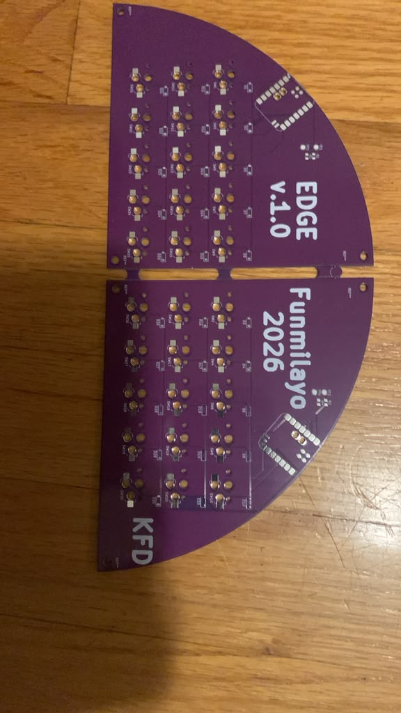
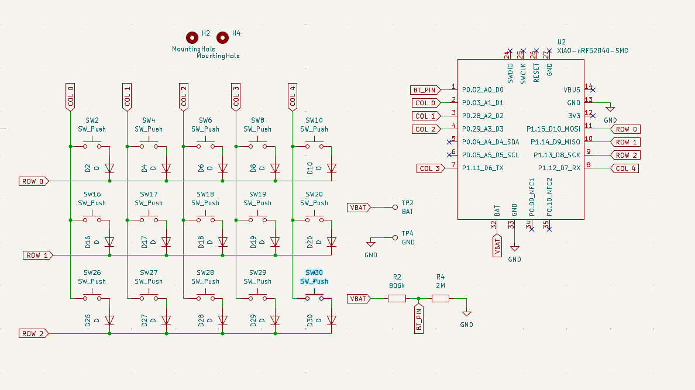
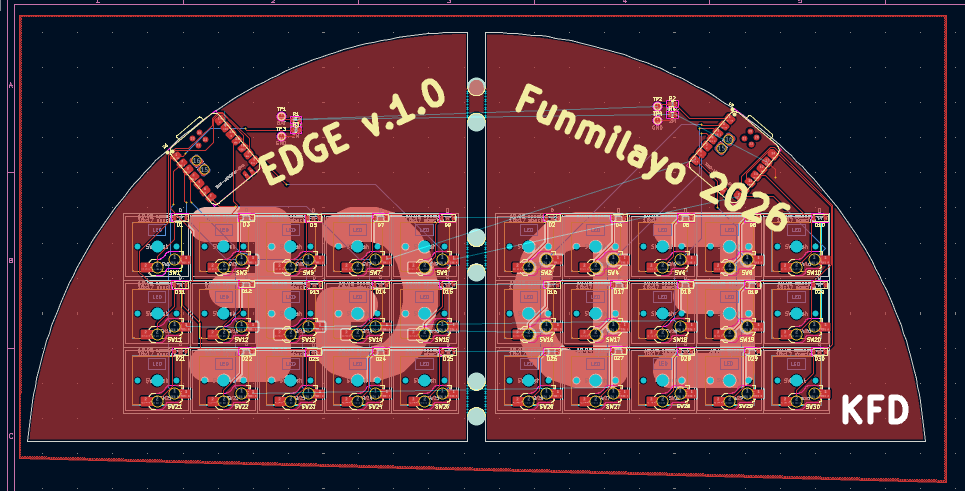
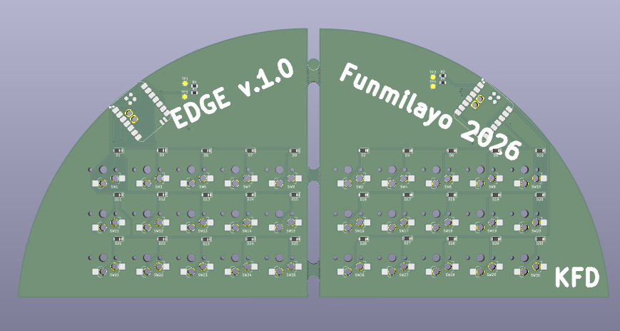
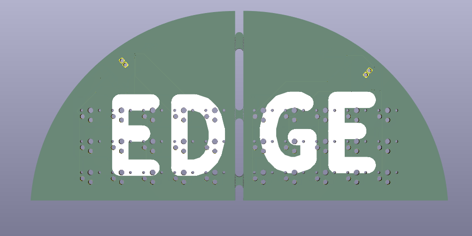
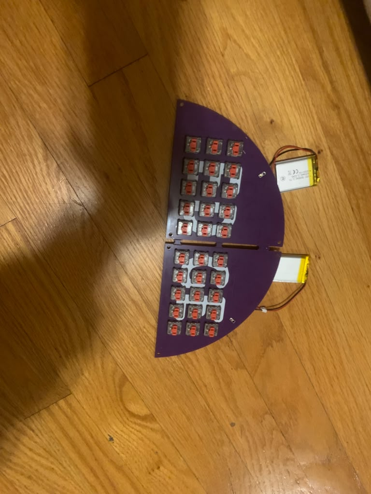

## This is EDGE, my Split Keyboard! 30 keys (can you beat that?) and three layers to cover almost all keyboard inputs! There's the normal, number, and bluetooth layers!

Please note that the firmware files are in a different repo: 
https://github.com/Dee-24r/zmk-config-edge

 
**Physical pcb arrived 3 days ago, I'l assemble soon!**

Here are pictures of my design files

# build!

[https://github.com/Dee-24r/Edge/blob/main/images/malfunctioning_keeb.mp4](https://github.com/user-attachments/assets/b93cf569-b797-47ab-8092-d4cc0c10ea89)
